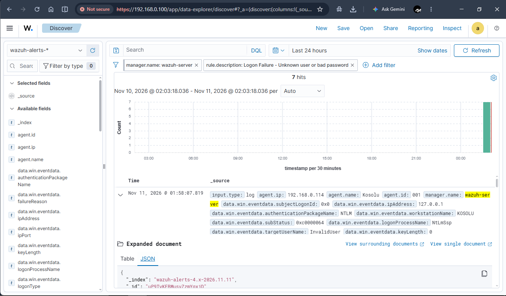

# Project 1: SIEM Alert Investigation & Incident Analysis

## 📌 Objective
Deploy a centralized Wazuh SIEM virtual appliance, register a Windows endpoint agent, simulate unauthorized access attempts (brute-force authentication failures), and investigate the resulting security alerts as a Tier-1 SOC Analyst.

---

## 🛠️ Lab Environment & Architecture
* **SIEM Platform:** Wazuh v4.14.10 (Hosted on Oracle VirtualBox via Bridged Adapter mode)
* **Endpoint Operating System:** Windows (Agent Name: `Kosolu`)
* **Detection Mechanism:** Wazuh Agent log collection monitoring Windows Security Event Logs (`Event ID 4625`)

---

## 🔍 Incident Investigation & Evidence

### 1. Alert Overview
* **Alert Name:** `Logon Failure - Unknown user or bad password`
* **Rule ID / Level:** Mapped to Windows Event ID 4625 (Low/Medium Severity)
* **Description:** An account failed to log on due to incorrect credentials or an unknown username.

### 2. Log Fields & Captured Metadata
* **Timestamp:** `Nov 11, 2026 @ 01:58:07.819`
* **Agent Name:** `Kosolu` (Agent ID: `001`)
* **Source IP / Host:** `127.0.0.1` (Local loopback simulation)
* **Target User Name:** `InvalidUser`
* **Log Channel:** Security (`Microsoft-Windows-Security-Auditing`)

### 3. Dashboard Evidence

---

## 🏷️ Severity Assessment & Classification
* **Assessed Severity:** **Low** 
* **Classification:** **Benign / Controlled Test Activity**
* **Justification:** The authentication failures were triggered intentionally via local PowerShell commands (`net use`) as part of a verification test for detection engineering, rather than an active malicious external threat campaign.

---

## 🛡️ Remediation & Recommendations
As a Tier-1 SOC Analyst, the following containment and hardening steps are recommended following this event:
1. **Threshold Monitoring:** Monitor for rapid spikes of Event ID 4625 originating from external or suspicious IP addresses to identify active password-spraying or brute-force attacks.
2. **Account Lockout Policies:** Enforce a strict account lockout policy (e.g., locking user accounts after 5 consecutive failed login attempts within
