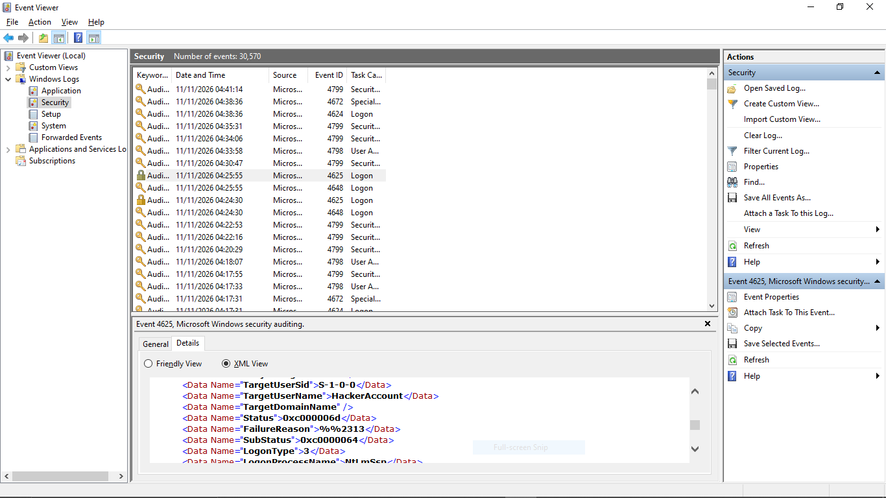

# Project 2: Windows Failed-Login Forensic & Event Log Analysis

## 📌 Objective
Perform deep-dive forensic analysis on raw Windows Security Event Logs (`Event ID 4625`) generated by failed authentication attempts. Differentiate between valid account password failures and invalid account targeting by analyzing key log metadata fields.

---

## 🛠️ Investigation Scope & Methodology
* **Target System:** Windows Endpoint (`Kosolu`)
* **Log Source:** Windows Security Event Log (`Microsoft-Windows-Security-Auditing`)
* **Event ID Analyzed:** `4625` (An account failed to log on)
* **Tools Used:** Windows Event Viewer, Wazuh SIEM Log Parser, PowerShell

---

## 🔬 Scenario Analysis & Findings

### Scenario A: Authentication Failure on Existing Account
* **Target User:** `Administrator`
* **Logon Type:** `3` (Network Logon)
* **SubStatus Code:** `0xC000006A` (User name is valid, but bad password)
* **Source IP:** `127.0.0.1`
* **Analyst Note:** Indicates potential targeted credential guessing against a known high-privilege account.

### Scenario B: Authentication Failure on Non-Existent Account
* **Target User:** `HackerAccount`
* **Logon Type:** `3` (Network Logon)
* **SubStatus Code:** `0xC0000064` (User name does not exist)
* **Source IP:** `127.0.0.1`
* **Analyst Note:** Indicates potential automated user enumeration or brute-forcing using dictionary wordlists.

---

## 📊 Key Windows Event ID 4625 Reference Table

| Field Name | Scenario A Value | Scenario B Value | Forensic Significance |
| **TargetUserName** | `Administrator` | `HackerAccount` | Identifies targeted user identity. |
| **LogonType** | `3` | `3` | Differentiates local console logins (`2`) from network/RDP access (`3`/`10`). |
| **SubStatus** | `0xC000006A` | `0xC0000064` | Distinguishes wrong passwords from invalid usernames. |

---

## 🛡️ Incident Response & Mitigation Playbook
1. **Differentiate Attack Types:** Prioritize alerts displaying `0xC000006A` on critical accounts over random `0xC0000064` noise.
2. **Implement Network Segmentation:** Restrict SMB (Port 445) and RDP (Port 3389) exposure to untrusted networks.
3. **Automate SIEM Correlation:** Create detection rules that trigger high-severity alerts when `SubStatus 0xC000006A` hits a threshold of 5 attempts within 60 seconds.
